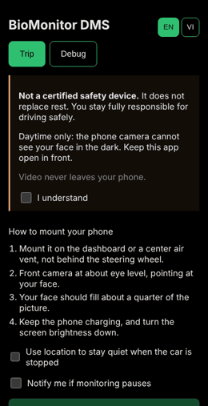

# BioMonitor DMS

A driver monitoring system that runs entirely in your phone's browser.
It watches for microsleep, growing fatigue and eyes-off-road time, and warns you
with calm, step-by-step alerts.

**No video ever leaves your device.** There is no server, no account and no analytics.

<p align="center"></p>

> ⚠️ **Status: v0.1.0 preview.** The full trip flow works: setup check, per-driver
> calibration, Dark Cockpit monitoring, and microsleep / eyes-off-road / fatigue alerts,
> in English and Vietnamese, online or offline. It has been tested with replayed video,
> not yet in real driving. Do not rely on it while driving. See [CHANGELOG.md](CHANGELOG.md).

## Important limits

- **Not a certified safety device.** It does not replace rest. You stay fully responsible for driving safely.
- **Daytime / lit conditions only.** Phone front cameras have no infrared, so the app can't see your face in the dark.
- **Keep it in the foreground.** If you switch apps or take a call, monitoring pauses.

## How it works

See the full spec: [`docs/SPEC.md`](docs/SPEC.md).

```
camera → frame loop (15 fps, 480 px) → vision worker (MediaPipe Face Landmarker)
       → numbers only: EAR, blink, MAR, head pose, gaze, light, jitter
       → One Euro smoothing → quality gates
       → calibration (your own baseline) → detectors (eyes closed, off road, PERCLOS, yawns, nods)
       → state machine → alerts (sound, voice, vibration, screen)
```

A trip goes: **Start** → setup check (face, light, distance, beep) → 8 s calibration
("look at the road, blink normally") → monitoring. Alerts step up from a soft beep
(eyes closed 1 s) to a loud alarm (2 s), and stop by themselves 2 s after your eyes open.

- The model and wasm files are **self-hosted** and checked against SHA-256 hashes in `assets.lock.json`. Nothing loads from a CDN at runtime.
- Production builds carry a strict **Content-Security-Policy** (the page may only talk to itself) and work **offline** after the first trip (installable PWA).
- If the worker can't start (for example on some iOS versions), the model runs on the main thread instead.
- The state machine (`src/core/fsm`) is pure TypeScript and fully unit-tested with scripted signal traces.
- The trip controller (`src/app/trip/controller.ts`) gets every device service injected, so the whole
  flow — including camera loss, stalls and app switching — is tested in Node with fakes.
- How each of the 20 failure modes is handled and tested: [`docs/FAILURE_MODES.md`](docs/FAILURE_MODES.md).

## Alert behavior (current rules)

Defaults from `src/core/config.ts`; the spec has the reasoning (§10, §11). Gaze = head angle plus
eye direction. Yaw: left is negative, right is positive.

**Where you look → how long before D1 (distraction alarm)**

| You look at | Gaze zone (yaw / pitch) | Time before D1 | Counts toward 6 s in 30 s |
| --- | --- | --- | --- |
| The road, or up | yaw within ±30° and pitch above −15° | never | no |
| Left mirror | yaw −30° to −60° | 2.5 s | no |
| Left window / behind | yaw beyond −60° | 2.0 s | no |
| Right mirror | yaw 50° to 75° | 2.5 s | no |
| Right window (30–50° or beyond 75°) | the rest of the right side | 2.0 s | no |
| Rear-view mirror | yaw 18° to 45°, pitch above +8° | 3.0 s | no |
| Speedometer | pitch below −15°, yaw within ±20° | 2.0 s | no |
| Console / radio | pitch below −15°, yaw 10° to 40° | 2.0 s | yes |
| Lap / phone | pitch below −30°, or any other low look | 2.0 s | yes |

D2 follows 1.5 s after D1. A new zone must last 150 ms to count, so a flick is ignored. The
attention buffer (2 s) refills while you look at the road, so short glances with road time
between them never add up.

**Context that changes the times**

| Situation | Effect |
| --- | --- |
| Speed 30 km/h or more (or no GPS) | The table above |
| 10–30 km/h | Mirror and side looks get 3.5 s. Phone, console and lap stay 2.0 s |
| Below 10 km/h | No distraction alarms, microsleep only. Below 3 km/h: no alarms at all |
| Location ticked, but **no speed reading** (indoors, desk) and the phone very still for 3 s | Counts as parked (below 10 km/h): no distraction alarms, only microsleep (L) |
| Location unticked | No speed class at all: always armed |
| Car turning and you look into the turn | Allowed for up to 4 s |
| Face lost after a fast head turn | Blind-spot check: D1 after 1.5 s |
| Face lost after a fast head drop | Counted as eyes closed |
| Eyes on phone 2 s while stopped, then the car moves | D1 at once |

**Eyes closed, and what each alert does**

| Alert | Trigger | Sound | Stops when |
| --- | --- | --- | --- |
| L1 | Eyes closed 1.0 s (heavy lids 3 s, 3 slow closures in 60 s) | Two soft tones | Eyes open and head level for 2 s |
| L2 | Eyes closed 1.5 s | Rising chirp, repeats | L1 after 1 s with eyes open |
| L3 | Eyes closed 2.0 s, or face lost in danger | Loud siren, red flash | L1 after 1 s with eyes open |
| D1 | See the first table | Two soft tones | Back on the road for 1 s |
| D2 | D1 plus 1.5 s, or 3.5 s off road, or more than 6 s of phone/console/lap in 30 s | Rising chirp | Back on the road for 1 s |
| Advisory | PERCLOS above 15%, 6 slow blinks in 5 min, 3 yawns in 10 min, 1 nod in 5 min | Calm voice, once per 10 min | By itself |
| Strong advisory | PERCLOS above 25%, 12 slow blinks, 5 yawns, 2 nods | Voice, once per 5 min | By itself |

### Test the alerts at a desk

The phone sits in a stand slightly above eye level. On the start screen:

1. **Untick "Use location…".** With location off the app is always armed. If it stays ticked indoors,
   there is no speed reading, a phone sitting still counts as parked, and distraction alarms (D1/D2)
   stay silent while microsleep alarms (L) still fire. Motion sensors can stay on.
2. Calibrate (8 s, look straight ahead, blink normally).
3. Turn your head to the yaw in the table and hold it longer than its time. Look down at your lap or a
   phone held below the camera for 2 s. Close your eyes for 1 s, then 2 s.

Easier: tick **"Behavior check panel"** on the start screen (or open `?test`, or press the button in the
Debug tab). It turns location off for you and, during monitoring, shows the alarm state, where you look,
head angle, eye openness, the attention buffer and an alert history. Pick an action, press *Start test*,
do it, and it says whether the alarm matched what the rules expect.

For the same cases without a person, run `npm run scenarios`. The Debug tab shows raw signals only
(each with a plain-language note in English and Vietnamese).

## Develop

Requires Node 22+.

```bash
npm install
npm run dev        # http://localhost:5173 — fetches and verifies model files first
npm test           # unit + golden-trace tests
npm run check      # typecheck + lint + tests
npm run build      # production build
```

### Debug mode

Open the **Debug** tab (or `http://localhost:5173/?debug`) and tap **Start camera**.
You get the camera preview with landmarks, live readouts and charts for EAR, blink,
mouth, head pose, gaze and performance.

Useful URL switches: `?delegate=cpu` forces the CPU model, `?worker=0` forces the main-thread fallback.

Use Debug mode parked or at a desk only.

### Test on a phone

Phones only allow the camera on HTTPS. Run:

```bash
npm run dev:phone
```

Open the `Network: https://…` address on a phone on the same Wi-Fi. Accept the
self-signed certificate warning (development only).

### Replay a video (for tuning)

The replay harness plays a video as a fake camera in Chromium, runs the real pipeline,
and saves every frame's numbers as JSON:

```bash
npx playwright install chromium     # once
npm run build
ffmpeg -i my-clip.mp4 -vf scale=640:480 -r 30 -pix_fmt yuv420p clips/my-clip.y4m
npm run replay -- --clip clips/my-clip.y4m --seconds 10
# → replay-out/my-clip.json
```

Trip mode runs the whole trip flow on the clip and records the phase and alert timeline:

```bash
npm run replay -- --mode trip --clip clips/my-clip.y4m --seconds 40 --expect-alerts L1,L2,L3
```

`clips/` and `replay-out/` are git-ignored. **Never commit videos of real people.**
`npm run smoke` runs the same harness on a generated dark clip (used in CI).

### Alert accuracy scenarios

The [alert accuracy plan](docs/ALERT_ACCURACY_PLAN.md) lists 101 situations where alerts can go
wrong (intersections, mirrors, red lights, texting, squinting, …). Each one is a scripted
scenario in `src/scenarios/` that runs through the real detectors and state machine:

```bash
npm run scenarios                 # writes docs/SCENARIO_REPORT.md
npm run scenarios -- --only A07   # one scenario with its alert timeline
npm run tune                      # how far each threshold can move: docs/TUNING_REPORT.md (~6 min)
npm run tune -- --param budgets.lapMs
```

`npm test` includes a ratchet: a scenario that passed in `src/scenarios/baseline.ts` must keep
passing. After a fix, record the new passes with `npm run scenarios -- --update-baseline`.

Progress: v0.1 passed 40 scenarios; after P2 (speed context, motion sensors, gaze zones) **66**;
after P3 (attention buffer, scanning, face-lost context) **72**; after P4 (eye-closure
robustness, drowsy eyes, clean fatigue signals) **90**; after P5 (alarm behavior) **94** of 102
— every synthetic case. P6 added 20 boundary pairs (group G: just under / just over each
threshold), so a threshold that moves ~15% now breaks a test: **114 pass**. The other 8 need
real recorded clips (P7).

After a trip, the summary lets the driver mark an alert as a false alarm. Each mark loosens
that alert type by 5%, at most +10%, stored only on the phone. Phone looks and long eye
closures (L2, L3) never change.

### Real clips (P7)

The synthetic scenarios guess some numbers (how low the lids drop on a speedometer glance,
what a laugh looks like). Check them on your own face: record short clips **parked or at a
desk, never while driving**, describe them in `clips/manifest.json`, and run:

```bash
npm run build && npm run clips   # → clips/CLIP_REPORT.md
```

Each clip plays through the real model in Chromium and is judged by the same code as the
scenarios. A short "sign check" clip also confirms the head and eye direction signs for your
phone. `clips/` is git-ignored: it shows a real face. Guide:
[docs/P7_RECORDING_GUIDE.md](docs/P7_RECORDING_GUIDE.md).

### Project layout

```
src/core/            pure TypeScript (no DOM): config, types, filters, quality gates,
                     calibration, detectors, state machine
src/vision/          MediaPipe wrapper, feature math, worker, engine (worker + main-thread fallback)
src/platform/        camera, frame loop, audio, wake lock, vibration, speed, watchdog
src/app/trip/        trip controller + Trip screen
src/app/debug/       Debug mode
src/scenarios/       alert-accuracy scenario library, runner and baseline
scripts/             asset fetch + hash check, replay harness, test clip generator
docs/SPEC.md         product and technical spec
docs/FAILURE_MODES.md  failure-mode coverage
```

Code rules: TypeScript strict, function components, no default exports.

## Deploy

The app is a folder of static files (`dist/`) and must be served over **HTTPS** (camera).

- **Cloudflare Pages (recommended):** build command `npm run build`, output folder `dist`.
  It reads the generated `dist/_headers`, so the strict CSP covers the page **and** the vision worker.
- **GitHub Pages:** run the *Deploy to GitHub Pages* workflow by hand (Actions tab) after
  enabling Pages (Settings → Pages → Source: GitHub Actions). GitHub Pages cannot send headers,
  so only the page gets the CSP (via a `<meta>` tag), not the worker.

New versions are never applied in the middle of a trip: the start screen offers "Update now".

### Use it on your phone

Pick one. The camera only works over HTTPS.

**A. Try it now, no deploy** (phone and computer on the same Wi-Fi):

```bash
npm run dev:phone
```

Open the `Network: https://…` address on the phone and accept the certificate warning.
It stops when you close the terminal.

**B. Keep it on the phone: Cloudflare Pages (free, recommended)**

1. Push the repo to GitHub.
2. Cloudflare dashboard → Workers & Pages → Create → Pages → Connect to Git → pick the repo.
3. Build command `npm run build`, output folder `dist`, environment variable `NODE_VERSION` = `22`.
4. Deploy. You get an `https://<name>.pages.dev` address. Each push to `main` redeploys.

**C. GitHub Pages** (the page gets the CSP from a meta tag, the worker does not)

1. Repo → Settings → Pages → Source: **GitHub Actions**.
2. Actions → *Deploy to GitHub Pages* → Run workflow.
3. The address is `https://<user>.github.io/<repo>/`.

**On the phone**

- Open the address once online, then *Add to Home Screen* (iPhone: Share → Add to Home Screen;
  Android: menu → Install app). After the first load it works offline.
- Allow the camera. Leave "Use location" ticked only when driving; indoors, use the behavior check panel.
- Turn the media volume up. **iPhone: flip the ring switch to ring**; a silent switch can mute the tones
  on older iOS (the app asks for a playback audio session, which fixes it on current iOS).
- Keep the app open in the foreground with the screen on. Use a mount below eye level, camera on the face.

## Roadmap

| Milestone | Scope |
| --- | --- |
| **M0** ✅ | Tooling, CI, core types, config, state machine + tests |
| **M1** ✅ | Camera, vision worker + fallback, signals, quality gates, Debug mode, replay harness |
| **M2** ✅ | Calibration, detectors, alerts (sound, voice, vibration), Wake Lock, watchdog, trip controller |
| **M3** ✅ | Dark Cockpit UI, onboarding, Vietnamese, offline PWA, CSP, battery + pause notification — **v0.1.0** |
| **P1–P6** ✅ | Alert accuracy: 102-case scenario library + ratchet; speed context, motion sensors, gaze zones, hysteresis; attention buffer, face-lost context; robust eye closure, drowsy eyes, clean fatigue signals; smarter alarm behavior; boundary pairs, tuning report, "false alarm" marking |
| **P7** 🎬 | Real-clip kit ready (`npm run clips`, sign check, recording guide) — waiting for recordings |
| Next | Fixes from the clip report · GPS / gyroscope checks on a real drive |

## License

[MIT](LICENSE). MediaPipe is Apache-2.0.
